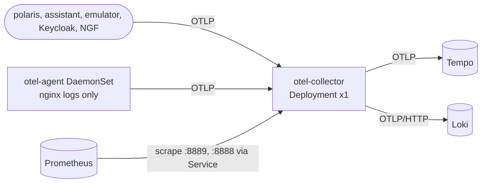
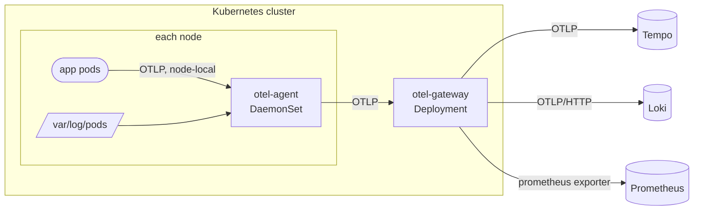

# Observability: Agent and Gateway Collector Tiers

- **Scope:** move the Kubernetes telemetry path from "apps → one Collector Deployment → backends" to a layout that separates internal app services from the observability backends (Prometheus, Tempo, Loki) behind a standard OTLP boundary. The first pipeline behind that boundary is a node-level **agent** (DaemonSet) and one **gateway** (Deployment), the only component connected to the backends
- **Target:** the kind cluster from [Kubernetes Deployment](k8s-deployment.md). Compose (`docker/telemetry`) keeps its single Collector and is out of scope
- **Depends on:** K4 (Collector, log agent) and K12 (Prometheus) of [Kubernetes Deployment](k8s-deployment.md), which are done
- **Status:** Draft for review, current state refreshed 2026-10-22 (no slice started)

## Goal

Separate the observability backends from the internal application services of the cluster, with a standard interface
on each side and a replaceable processing pipeline between them.

- **App side:** workloads emit telemetry over OTLP to an endpoint that is local to them. They know nothing about the
  backends, how telemetry is processed, or how many processing stages there are.
- **Backend side:** the backends (Tempo, Loki, Prometheus) receive telemetry only over their standard ingest
  interfaces, from one trusted egress point. Nothing else in the cluster has a route to them.
- **Between them:** the processing pipeline (enrichment, redaction, cardinality control, and later sampling or extra
  tiers) can change freely. Changing it never changes the OTLP contract on either side, so neither apps nor backends
  are touched.

No application code changes. Only the OTLP endpoint in each app's ConfigMap moves, once.

The initial pipeline is deliberately small: a node agent and one gateway (see Target architecture).

## Current state

- Apps and the Gateway send OTLP straight to the `otel-collector` Service (`base/polaris-assistant/configmap.yaml`,
  `platform/nginx-gateway-fabric/values.yaml`, ...). The agent exists only to tail nginx logs: no OTLP receiver, no
  listening ports, no API token, and its only exporter is `otlp_grpc/collector`.
- `k8s_attributes`, redaction and the metric allow-list all run in the one Collector tier (`replicaCount: 1`), whose
  ClusterRole reads pods, namespaces and replicasets.
- Metrics leave through the `prometheus` exporter (:8889). Prometheus scrapes the `otel-collector` Service for it
  (`otel-collector` job, :8889) and for the Collector's self-metrics (`otel-collector-self`, :8888).
- Node-level telemetry already exists beside the Collector: `platform/node-exporter` runs in the `otel` namespace
  (Pod Security `privileged`) and Prometheus scrapes it per pod.
- Nothing from this plan is implemented yet.

## Target architecture

| Tier | Owns | Does not do |
|:--|:--|:--|
| **Agent** (per node) | Receive OTLP from local pods, `k8s_attributes` for the node's pods, `memory_limiter`, `batch`, tail container logs, bounded retry and queue | Redaction policy, sampling, any backend credential or address |
| **Gateway** (one Deployment) | Redaction, cardinality allow-list, nginx span fixes, the only connection to the three backends, backend queues and retries | Reading the Kubernetes API for pod metadata, tailing files, sampling |

Principles applied: standard OTLP between every hop (Principle 1.2), no custom retry loops, only the Collector's
`sending_queue` and `retry_on_failure` (1.2), W3C trace context passes through unchanged, and every tier exports its
self-metrics (Principle 3.1).

## Decisions

| # | Decision | Default chosen | Why | Alternative |
|:--|:--|:--|:--|:--|
| D1 | How apps reach the agent | **A `Service` with `internalTrafficPolicy: Local`** in front of the DaemonSet | The `polaris` namespace enforces Pod Security `restricted`, which forbids `hostPort`. A Local Service keeps the app configuration a normal DNS name and sends traffic to the same-node agent only | `hostPort` plus node IP via the downward API (blocked by PSA); a plain ClusterIP Service (loses node locality) |
| D2 | Agent → gateway | **Plain OTLP/gRPC to the gateway's ClusterIP Service**, as the agent does today | One gateway replica needs no load balancing or routing key. Nothing else to run or explain | `loadbalancing` exporter and a headless Service (only needed for several replicas or tail sampling) |
| D3 | Metrics into Prometheus | **Keep the `prometheus` exporter**, scraped through the gateway Service | Works today and is correct with one replica | Prometheus native OTLP receiver or `prometheusremotewrite` (no gain at this size) |
| D4 | Where `k8s_attributes` runs | **Agent**, with the watch filtered to its own node (`filter.node_from_env_var`) | At the gateway the connection IP is the agent's, so pod association fails. A node-filtered watch also keeps API-server load flat as the cluster grows | Keep at the gateway and have apps set `k8s.pod.uid` themselves |
| D5 | Where redaction runs | **Gateway only** | One policy, one place to change. The agent never sees backends | Both tiers (duplicated rules drift) |
| D6 | Names | Agent keeps `otel-agent`. The current `otel-collector` is renamed **`otel-gateway`** in O4, after nothing points at the old name | An honest name for the role, and the rename is a separate mechanical change | Keep `otel-collector` |
| D7 | Tail sampling, gateway pool, WAL | **Out of scope** | No requirement. Adding them later is a new plan: trace-ID routing in a second layer, several gateway replicas, a persistent queue | |

## Technical requirements

| ID | Requirement |
|:--|:--|
| TR-O1 | **Standard interfaces only:** every hop is OTLP (gRPC or HTTP). Backends are reached by the same addresses as today |
| TR-O2 | **No config in the image or the values for secrets or addresses beyond Service DNS names**, as today |
| TR-O3 | **Bounded loss:** each tier has a `memory_limiter`, a bounded `sending_queue` and capped retries. A backend outage drops data after the queue fills and never back-pressures an app for long |
| TR-O4 | **Backends are not exposed:** only the gateway has egress to Tempo, Loki and Prometheus' write or scrape path. Apps and agents have none. NetworkPolicies allow exactly the flows in the diagram, on both ends, default deny stays |
| TR-O5 | **Least privilege:** the agent's API access is read-only on pods, namespaces and replicasets. It keeps `readOnlyRootFilesystem`, drops all capabilities and listens only on 4317 and 4318. The gateway has no API access |
| TR-O6 | **Observable:** both tiers expose self-metrics scraped by Prometheus. A dashboard shows per tier accepted, refused and dropped items and exporter queue use |
| TR-O7 | **No regression:** a smoke test sends a trace, a log and a metric from an app pod and finds all three in the backends with the right `k8s.*` attributes and redaction applied |
| TR-O8 | **Reversible per slice:** each slice leaves the stack working. Apps move to the agent last, so rollback is one ConfigMap value |

## Changes: current → target

The order keeps the stack working at every step: build the agent's new role, cut over, then simplify the gateway.

### O1 · Agent receives OTLP (agent only)

- `platform/otel-agent/values.yaml`: enable the `otlp` receiver (4317, 4318) and add `k8s_attributes` filtered by node, with a ClusterRole for pods, namespaces and replicasets. This turns off `automountServiceAccountToken: false` on the agent, so record the reason in the file header (TR-O5).
- Add the `traces` and `metrics` pipelines (`memory_limiter`, `k8s_attributes`, `batch` → `otlp_grpc/collector`) beside the existing logs pipeline. Logs get `k8s_attributes` too, which retires part of the file-path derived attributes.
- Add the Local Service `otel-agent` (D1) in `platform/otel`.
- `platform/otel/network-policies.yaml`: allow apps → agent 4317 / 4318 (both ends), agent → Kubernetes API.
- **Verify:** from a debug pod on a node, send OTLP to the agent Service and see it in Tempo with `k8s.*` attributes. Nothing else changes yet.

### O2 · Cut apps over to the agent

- ConfigMaps of `polaris`, `polaris-assistant`, `polaris-fulfilment-emulator`, the Keycloak manifest and `nginx-gateway-fabric/values.yaml`: point `OTEL_EXPORTER_OTLP_ENDPOINT` (and the nginx tracing endpoint) at `otel-agent.otel.svc.cluster.local` instead of `otel-collector`.
- `base/network-policies`: change the apps' egress rule from the Collector to the agent. Remove the apps → gateway ingress rule from `platform/otel/network-policies.yaml`.
- **Verify:** TR-O7 smoke test for each app. The gateway's `accepted` counters now come only from the agents.

### O3 · Gateway-only policy and self-metrics

- Remove `k8s_attributes` and its ClusterRole from the gateway (D4). The gateway no longer needs the API server, so drop that egress rule.
- Add the agent to Prometheus scrape config (per pod) and the tier dashboard under `platform/grafana` (TR-O6).
- **Verify:** the gateway pods run without an API token. Redaction tests (existing) still pass because they run against the gateway.

### O4 · Rename and clean up

- Rename the gateway to `otel-gateway` (D6) across values, Service names, NetworkPolicies, scrape jobs, dashboards and docs. Remove leftover rules that mention the old name.
- Update `docs/` architecture pages so every claimed capability maps to a component (Principle 1.3).

## Slice tracker

| Slice | Change | Bounded context | Status |
|:--|:--|:--|:--|
| O1 | Agent OTLP receiver, `k8s_attributes`, Local Service, policies | Observability platform | Todo |
| O2 | Apps and Gateway send to the agent | Per app ConfigMap, one PR per context | Todo |
| O3 | Gateway without API access, agent scrape and dashboard | Observability platform | Todo |
| O4 | Rename `otel-collector` → `otel-gateway`, docs | Observability platform | Todo |

O2 touches several app contexts but changes only an endpoint value in each. Split it into one change per app if the
reviewer prefers (Principle 2.2).

## Risks

| Risk | Mitigation |
|:--|:--|
| `internalTrafficPolicy: Local` drops traffic from a node with no agent pod ready | The DaemonSet tolerates all node taints. O2 verifies each node. Rollback is the previous endpoint value |
| The single gateway replica is a point of failure: a restart drops what is in its queue | Agent keeps a bounded retry queue, so a short restart is absorbed. Scaling out is a separate plan (D7) |
| Agent API access widens the attack surface of every node | Node-filtered watch, read-only ClusterRole, no other permissions (TR-O5) |
| Resource use grows with one more hop | Agent requests stay small (the log agent requests 20m / 64Mi today). Measure in O1 before sizing |
| kind has a single node, so node-locality bugs stay hidden | Run the O1 and O2 verification on a multi-node kind config before merging O2 |
