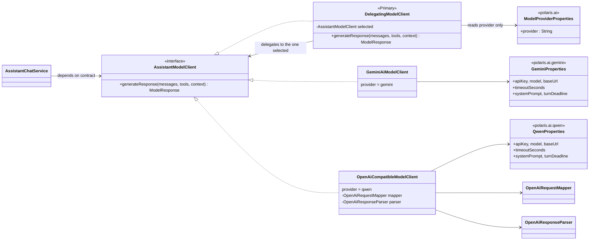

# Qwen Model Client

- **Scope:** `polaris-assistant`, add Qwen provider for `AssistantModelClient` reasoning model.
- **Reference:** `GeminiAiModelClient`
- **Status:** Approved (2026-10-17): §7 decisions accepted as recommended

## 1. Problem statement

Polaris Assistant depends on Gemini for reasoning, it's critical integration point and there are risks:
- A single point of failure
- Cost-effective

So we consider to add one more option for reasoning, and we use Ollama with Qwen model.

## 2. Design principle: one protocol client, not a "Qwen" protocol

Qwen has no wire protocol of its own. It is a **model family** served over the de-facto standard **OpenAI Chat Completions** API (AGENTS.md P1: align with the standard lower layer, not a bespoke abstraction). Both Ollama and DashScope speak it.

So the class is `OpenAiCompatibleModelClient`, selected by `polaris.ai.provider=qwen`, with Qwen as the default model name. Pointing `base-url` at Ollama (local) or DashScope (hosted) needs no code change.

### Class diagram

`AssistantChatService` keeps depending on the `AssistantModelClient` contract only. `DelegatingModelClient` also implements that contract and is the single entry point: it reads **only** `polaris.ai.provider` (`ModelProviderProperties`) once at startup and delegates every call to the matching provider client. Each provider client owns its complete configuration (`GeminiProperties`, `QwenProperties`); settings such as `systemPrompt` and `turnDeadline` are deliberately duplicated per provider rather than shared. Providers never know about each other. The shared `AssistantAiProperties` goes away.



Behaviour of one call: `AssistantChatService` → `DelegatingModelClient` → selected provider client (wrapped by its circuit breaker, see X3) → `ModelResponse`. Failures surface unchanged as `ModelUnavailableException` (X1), so the chat API's 503 mapping does not care which provider ran.

## 3. Main requirements (functional)

The contract is the existing `AssistantModelClient` interface; the new client is a drop-in for Gemini. The wire format is the public [OpenAI Chat Completions API](https://platform.openai.com/docs/api-reference/chat/create) (`POST {base-url}/v1/chat/completions`, `stream=false`), which is not restated here. Only what the plan adds or deviates from is listed.

| ID | Requirement |
|:--|:--|
| F1 | **Qwen behaviours beyond the spec.** (a) `tool_calls[].function.arguments` is a JSON **string**: parse to `Map`; malformed → empty args + `warn`, not a failure. (b) `<think>…</think>` blocks (Qwen3 reasoning) are stripped from `text` (§7.5). (c) A tool call without an `id` (some Ollama models) gets a stable generated one, so the `tool` message can carry `tool_call_id`. (d) No `thoughtSignature`. |
| F2 | **Provider selection.** `DelegatingModelClient` (`@Primary`, implements `AssistantModelClient`) delegates to the client named by `polaris.ai.provider` (`gemini` default, `qwen`). Unknown value, or `qwen` without `base-url`, fails startup. One provider per deployment; no runtime failover. |

### Config (`application.yml`)

Each provider has its own block, so defaults never leak between providers. Existing env var names are kept for Gemini, so current ConfigMaps keep working.

```yaml
polaris:
  ai:
    provider: ${POLARIS_AI_PROVIDER:gemini}      # gemini | qwen
    gemini:                                      # was polaris.ai.*
      api-key: ${GEMINI_API_KEY:${POLARIS_AI_API_KEY:}}
      model: ${POLARIS_AI_MODEL:gemini-3.6-flash}
      base-url: ${POLARIS_AI_BASE_URL:https://generativelanguage.googleapis.com}
      timeout-seconds: ${POLARIS_AI_TIMEOUT_SECONDS:30}
      turn-deadline: ${POLARIS_AI_TURN_DEADLINE:25s}
      # system-prompt: default in GeminiProperties
    qwen:
      api-key: ${QWEN_API_KEY:}                  # blank is valid (Ollama)
      model: ${QWEN_MODEL:qwen3:4b}              # Ollama; DashScope: qwen-plus
      base-url: ${QWEN_BASE_URL:}                # required when provider=qwen, e.g. http://localhost:11434
      timeout-seconds: ${QWEN_TIMEOUT_SECONDS:60}  # local small models are slower
      turn-deadline: ${QWEN_TURN_DEADLINE:25s}
```

## 4. Cross-cutting concerns

Defined **once** here (AGENTS.md P3). They repeat in every slice, so slices do not restate them: **a slice is done only when its functional items (§3) pass and every X item below that its code touches is met.** Slice rows in §6 cite X IDs only where a slice needs something specific.

| ID | Concern | Requirement |
|:--|:--|:--|
| X1 | **Failure contract** | Same as Gemini: transport error, timeout or non-2xx → `ModelUnavailableException` carrying a failed `ModelCall` and any `Retry-After` (RFC 9110 §10.2.3). Failure text is never returned as a reply or persisted. |
| X2 | **Timeouts and deadline** | Per-call timeout (the provider's own `timeout-seconds`) capped by `ModelRequestContext.deadline()`. Exhausted deadline → `TurnDeadlineExceededException` inside `ModelUnavailableException`, with no HTTP request made. |
| X3 | **Resilience** | Each provider client is wrapped by its own named breaker (`gemini`, `qwen`) with retry inside it, applied beneath `DelegatingModelClient` (see §7.6), using the same retryable/non-retryable classification as Gemini (`ModelFailures`). Resilience4j only, no bespoke loops. |
| X4 | **Observability** | `@GenAiGeneration(provider = PROVIDER_QWEN)` with `ModelCall` filled: `requestModel`, `responseModel` (`model`), `responseId` (`id`), `usage` (`prompt_tokens`/`completion_tokens`), `finishReason` (`stop`/`tool_calls`/`length`). W3C `traceparent` propagates on the outbound call. Structured logs carry `trace_id`/`span_id`. Spans record exceptions. Prompt/response content follows `content-capture` (never logged raw). |
| X5 | **Configuration and secrets** | All values from environment (12-factor): `QWEN_API_KEY`, `QWEN_BASE_URL`, `QWEN_MODEL`. Nothing hardcoded; the key is never logged. |
| X6 | **Test floor** | Tests go through the real HTTP interface with WireMock (as in `GeminiAiModelClientWireMockTest`) and cover: happy path, edge case, error response, timeout, and telemetry. Mock only at the external boundary. |
| X7 | **Structure** | Single-responsibility units, one-way dependencies: request mapper, response parser, transport client. No god class (the Gemini client is the cautionary example). `GeminiAiModelClient` stays unchanged. |
| X8 | **Authentication** | `Authorization: Bearer {api-key}` only when the key is non-blank (DashScope needs it, Ollama does not). A blank key is **valid** for Qwen, unlike Gemini's local-echo fallback. The key is never logged (see X5). |
| X9 | **Health** | `/actuator/health` shows the selected provider (`qwen` or `gemini`) as an informational contributor, not in readiness (A5). Probe: `GET {base-url}/v1/models`, within the provider's timeout. |

## 5. Out of scope

- Streaming (`stream=true`). The service uses non-streaming calls today.
- Automatic Gemini ↔ Qwen failover (see §7.2).
- Changing intent classification (TypeSafe stays as is).
- K8s manifests and Grafana panels for `qwen` (follow-up slice after the client lands).

## 6. Slices

Every slice also satisfies §4 (see the rule there). The table lists only what is **specific** to each slice.

| Slice | Title | Functional | Cross-cutting focus | Slice-specific work and tests |
|:--|:--|:--|:--|:--|
| S0 | **Refactor: rename, no behaviour change** | none | X5, X7 | `AssistantAiProperties` → `GeminiProperties` (`polaris.ai.gemini.*`) plus `ModelProviderProperties`; add `DelegatingModelClient` delegating to Gemini only; `ResilientGeminiModelClient` → `ResilientModelClient(provider)` (§7.6); `turnDeadline()` on the contract (§7.7). The existing suite stays green with only imports and config keys changed; add one delegation test |
| S1 | **Qwen client** | F1 | X1, X2, X4, X7, X8 | `OpenAiCompatibleModelClient` with mapper and parser; `QwenProperties`. Tests: text reply; tool-call reply (string args parsed); tool-result round trip carries `tool_call_id`; missing `id` generated; `<think>` stripped; Bearer header only with a key |
| S2 | **Enable Qwen** | F2 | X3, X5, X9 | Wire `qwen` into `DelegatingModelClient`; breaker `qwen` with retry; startup validation; Qwen health indicator; runbook line for `scripts/ollama.sh`. Tests: delegation per `provider`; unknown provider or missing `base-url` fails startup; breaker opens and the next call fails fast without HTTP; retry 503 → 200; no retry on 400; health UP/DOWN against WireMock `/v1/models` |

**Order:** S0 → S1 → S2.

## 7. Decisions

Accepted as recommended.

1. **Client name and shape.** A single `OpenAiCompatibleModelClient`; Qwen is configuration.
2. **Failover.** None in this plan; one provider per deployment, chosen by config.
3. **Tool-calling quality on small models.** `qwen3:4b` on 8 GB can call tools but is less reliable than Gemini on multi-step order flows. `qwen` is dev-only until the BDD suite (`assistant-bdd.md`) passes against it.
4. **PR granularity.** S0 on its own (pure refactor), then S1+S2 together (S1 alone is unreachable, so this keeps the PR vertically complete per P2.1).
5. **`<think>` handling.** Strip and drop (keeping it in telemetry would risk privacy under `content-capture`).
6. **Where the circuit breaker sits.** Generalise `ResilientGeminiModelClient` into one `ResilientModelClient(provider)` decorator wrapping each provider client, so `DelegatingModelClient` delegates to an already-guarded client. Gemini behaviour is unchanged and its tests stay green. Part of S0.
7. **Who reads `turnDeadline`.** Configured per provider (duplicated). `AssistantModelClient` gains `Duration turnDeadline()`; each provider returns its own, `DelegatingModelClient` forwards to the selected one, and `AssistantChatService` asks the contract instead of reading properties (`AssistantChatService.java:91`). Part of S0.

### Slice Tracker

Slices run top to bottom; only the `execute-plan` coordinator edits this table.

| # | Slice | Title | Status | External | Branch | PR | Notes |
|:--|:--|:--|:--|:--|:--|:--|:--|
