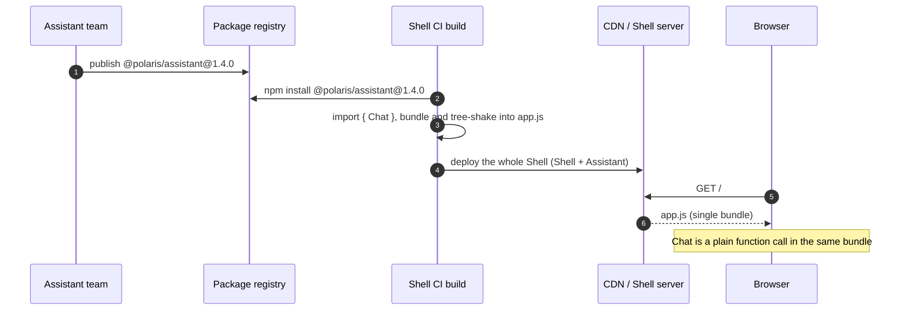
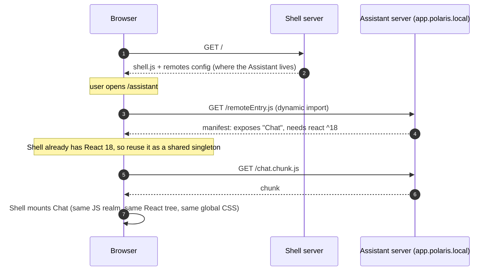
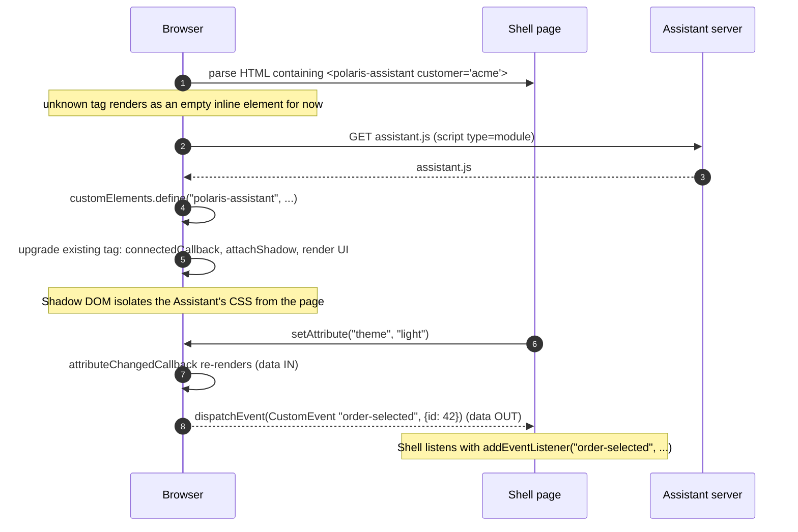

# ADR-0023: Micro-Frontend Composition Method for the Assistant Web App

* **Status:** Proposed (2026-10-27)
* **Deciders:** Polaris Architecture Team, Assistant Engineering
* **Date:** 2026-10-27
* **Technical Story:** Build a web front end for the assistant (chat, product and order cards) as a micro-frontend, hosted at `app.polaris.local`, so that it can be built and deployed independently of the shell that composes it.
* **Spec Reference:** [Assistant Frontend, Slice-1](../../development/specs/assistant-frontend.spec.md)
* **Builds on:** [ADR-0006](0006-grafana-domain-routing-and-tls-architecture.md) (domain routing and TLS), [ADR-0009](0009-gateway-subpath-routing-for-applications.md) (gateway sub-path routing)
* **Reference:** [Micro Frontends, Martin Fowler](https://martinfowler.com/articles/micro-frontends.html)

---

## 1. Context and Problem Statement
We're going to build a complex and flexible user facing applications. This is a SaaS system with following characteristics: 
- Customers are enterprises, so they might require different configuration like different set of application so that we might need different bundle for each customer. It would be better if we can config them at run-time.
- There might be apps that use for online marketing or their customers via social or any online omni-channels.
- There might be multiple product teams, so there might be a chance that they want different technology however we could consider based on trade-off.
- We're eager for new technology to solve the problem however simplicity is always our first choice if the problem is solved based on First-Principle.

---

## 2. Considered Options
- Build-time integration — independently developed frontend modules combined into one application at build time.
- Runtime integration using a JavaScript module loader — independently deployed frontend applications composed in the browser, commonly using Module Federation.
- Web Components with a shell application — independently developed frontend components integrated through browser-native component interfaces.

In all three options, the **Shell** is the host page that owns the header, navigation and login. The **Assistant** is the chat and card application the Shell must show. The options differ in *when* and *how* the Assistant's code gets into the Shell's page.

### 2.1 Build-time integration
The Assistant is published as a package (for example to npm). The Shell's build installs it, imports it like any library, and produces **one bundle**. A new Assistant version reaches users only when the Shell is rebuilt and redeployed.

* **Mental model:** a library dependency.
* **Per-customer variation:** needs separate builds or feature flags inside one bundle.

### 2.2 Runtime integration (JavaScript module loader / Module Federation)
The Assistant is **deployed independently** (for example at `app.polaris.local`). The browser fetches its code **while the page is running**, using a small manifest such as `remoteEntry.js`. Shared libraries (for example React) are negotiated so they are not downloaded twice.

* **Mental model:** lazy-loaded code from another deployment, with the bundler handling version matching.
* **Per-customer variation:** the list of remotes can come from runtime configuration.
* **Catch:** everything shares one JS realm and global CSS; shared dependency versions must be compatible; the approach is tied to a bundler plugin.

### 2.3 Web Components with a shell application
The Assistant ships as a **custom HTML element** (`<polaris-assistant>`). The browser integrates it through standard APIs. The contract is **attributes and properties in, DOM events out**.

* **Mental model:** like `<video>` or `<input>`, but custom-built.
* **Technology freedom:** the Shell and the Assistant may use different frameworks; the only coupling is the tag name, attributes and events.
* **Catch:** theming (CSS variables), routing and auth sharing must be designed explicitly; each component may bundle its own framework, increasing payload.

## 3. Comparison

### 3.1 Criteria
Criteria 1–3 come from the drivers in §1 (per-customer configuration, multiple teams and technologies); criterion 7 reflects the "simplicity first" tenet; criterion 9 reflects Principle 1 in `AGENTS.md`.

| # | Criterion | Question to ask | 2.1 Build-time | 2.2 Module Federation | 2.3 Web Components |
|---|---|---|---|---|---|
| 1 | Independent deploy | Can the Assistant ship without rebuilding the Shell? | No | Yes | Yes |
| 2 | Runtime configurability | Can customers get different module sets without different builds? | Weak (flags or separate builds) | Strong (runtime remotes list) | Strong (Shell chooses which tags and scripts to load) |
| 3 | Technology freedom | Can teams use different frameworks? | No (one toolchain) | Limited (same bundler, ideally same framework) | Yes (browser is the only contract) |
| 4 | Isolation | Can the Assistant break the Shell's CSS or JS? | None (same bundle) | Low (shared realm, global CSS) | CSS: high (Shadow DOM); JS: still shared |
| 5 | Integration contract | How explicit and stable is the interface? | Types and imports, checked at compile time | Exposed module and props, versioned by convention | HTML attributes and events, browser standard |
| 6 | Shared-dependency cost | Is anything downloaded twice? | Lowest | Low (negotiated singletons) | Highest unless managed |
| 7 | Simplicity and tooling | How much machinery must the team learn and run? | Lowest | Highest (bundler plugin, version negotiation) | Medium (standard APIs, but theming and routing are DIY) |
| 8 | Failure mode | What happens if the Assistant is down or a release is bad? | Shell build fails before users are affected | Runtime load error; needs fallback UI | Runtime load error; tag stays empty, needs fallback |
| 9 | Standards alignment | Does it rely on lower-layer standards or a bespoke abstraction? | npm and ES modules | Bundler-specific protocol | W3C Custom Elements and Shadow DOM |
| 10 | Observability and testing | Can each part be traced and tested on its own? | Easy (one app) | Needs cross-remote tracing | Easy per element; the attribute and event contract is testable |

> The ratings are general characteristics of each approach and have **not** yet been validated by a prototype.

### 3.2 How to use the criteria
1. **Weight the criteria.** If criteria 1–3 are all must-haves, option 2.1 is ruled out.
2. **Option 2.1 is the simplicity baseline.** Choose it only if customer variation and independent deploys do not justify more complexity.
3. **Options 2.2 vs 2.3 is the central trade-off.** 2.2 offers better performance and shared state but ties teams to one bundler and framework. 2.3 offers the loosest coupling and standard contracts but costs duplicate payload and requires building theming, routing and auth sharing.
4. **Validate with a spike.** A small prototype per option for Slice-1 (chat plus product and order cards at `app.polaris.local`) should measure criteria 4, 5 and 6: CSS leakage, contract clarity, bundle size and deploy steps.

